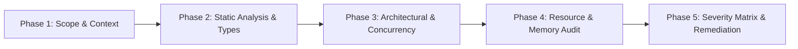

# Professional Procedural Code Review Skill

This skill defines the standardized procedure and checklist for conducting comprehensive, production-grade code reviews across all modules of the NLP2026 project.

---

## 1. When to Use This Skill
- Reviewing pull requests, feature additions, or architectural changes.
- Auditing existing source code for security, memory leaks, concurrency hazards, and bugs.
- Verifying compliance with project rules (e.g., no hardcoded drive paths, native dev-client requirements, memory offset parsing).
- Conducting pre-release quality assurance and performance profiling.

---

## 2. Review Methodology & Procedure

A professional review must follow a strict **5-Phase Procedural Workflow**:

### Phase 1: Scope & Inventory
- Enumerate modified or targeted files.
- Determine the domain layer: Mobile UI, Navigation, Zustand Store, Native AI Worklet/JSI, Python Model Generator, or Test Suite.

### Phase 2: Static Analysis & Type Safety
- Verify TypeScript types, generics, and null/undefined handling.
- Check for implicit `any` casting, unsafe type assertions (`as any`), or unvalidated JSON schemas.
- Verify Python parameter typing, docstrings, and argparse parameter validity.

### Phase 3: Architectural & Concurrency Review
- **Thread Safety:** Ensure heavy computations (`tflite.run`, resizing) do not block the JS event loop or UI Thread.
- **Race Conditions:** Inspect asynchronous effects, state subscriptions, navigation transitions, and unmount lifecycles.
- **Stale Closures:** Check `useCallback` and `useEffect` dependency arrays for missing or stale references.
- **Queue Starvation:** Ensure asynchronous worker queues (e.g. `processLoopRef` in `useSignLanguageModel.ts`) do not silently terminate when empty.

### Phase 4: Resource & Memory Lifecycle Audit
- **Memory Leaks:** Verify all event listeners (`AppState`, `NavigationBar`, `setInterval`, `setTimeout`) have corresponding unmount cleanup returns.
- **Native C++ Models:** Ensure native instances (e.g. `react-native-fast-tflite`) are tracked via mutable refs and released on unmount (`modelRef.current?.release()`).
- **C++ JSI & Buffers:** Ensure `ArrayBuffer` allocations do not fragment the Hermes heap; check that typed arrays use correct `byteOffset` and `Math.floor(byteLength / 4)`.
- **Filesystem & Cache:** Ensure temporary files created by `ImageManipulator`, `takeSnapshot`, or JSZip are sandboxed and purged in `finally` blocks.

### Phase 5: Findings Classification & Remediation
- Classify all issues by severity (Critical P0, Major P1, Moderate P2, Minor P3).
- Provide root-cause explanation and concrete drop-in remediation code.

---

## 3. Severity Classification Matrix

| Severity | Definition | SLA / Action Required |
| :--- | :--- | :--- |
| **P0 — Critical** | System crash, fatal native build break, data corruption, or severe memory leak. | Immediate blocker; must fix before merge/release. |
| **P1 — Major** | Functional logic bug, AI prediction degradation, thermal throttling, or stale closure. | Must fix before deployment. |
| **P2 — Moderate** | Suboptimal algorithmic complexity, unhandled edge-case, layout shift, or missing error boundary. | Should fix in the current sprint. |
| **P3 — Minor** | Code style inconsistency, deprecated API warning, or missing localization string. | Optional refinement. |

See [review_checklist.md](./references/review_checklist.md) for the comprehensive line-by-line inspection checklist.
