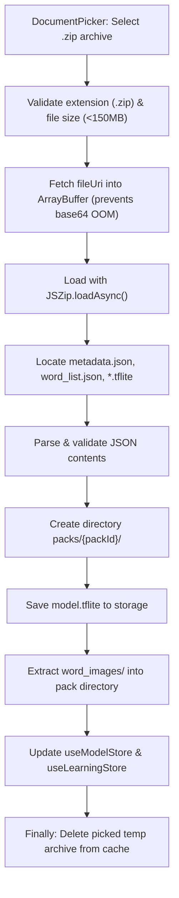

# Model Pack Management & Importer Skill

This skill guides AI agents through the lifecycle of Model Packs inside the mobile app: importing `.zip` archives, validating metadata and vocabularies, sandboxing files in local storage, and safe uninstallation.

---

## 1. When to Use This Skill
- Adding new pack import validation checks (e.g. file size limits, corrupt zip handling).
- Modifying how model files (`model.tflite`) or vocabulary illustrations (`word_images/`) are stored and resolved.
- Integrating new stores with model pack state (`useModelStore`, `useLearningStore`).
- Debugging custom pack loading issues or storage leaks.

---

## 2. Storage & Sandboxing Architecture

Model Packs are extracted into app-isolated directories:
```text
${FileSystem.documentDirectory}packs/${packId}/
├── model.tflite
├── metadata.json
└── word_images/
    ├── {word}.png
    └── ...
```

### Clean Wiping on Deletion
Deleting a pack in `useModelStore.deletePack(id)` wipes the entire directory `${FileSystem.documentDirectory}packs/${id}/` using `FileSystem.deleteAsync(packDir, { idempotent: true })`.
In addition:
- `useModelStore` resets `activePackId: state.activePackId === id ? null : state.activePackId` to prevent dangling references.
- `useModelManagerLogic` invokes `removePackWords(pack.id)` to purge orphaned vocabulary from AsyncStorage.
This guarantees **zero storage bloat** and pristine store states.

---

## 3. The Import Workflow (`src/src/utils/packImporter.ts`)



See [pack_importer_flow.md](./references/pack_importer_flow.md) for detailed error handling and code references.
