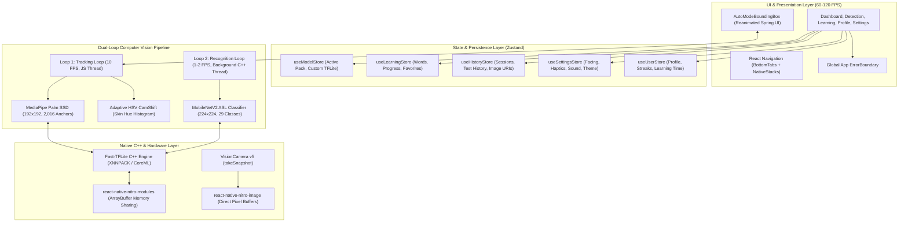

# NLP2026 — Comprehensive Architecture & Pipeline Specification

**Project:** NLP2026 Real-time On-Device Sign Language Detector  
**Revision:** 2.0  
**Target Platform:** Android & iOS (Native Dev-Client / EAS Build)  
**Core Technologies:** React Native 0.81, Expo SDK 54, Native C++ Nitro Modules, Fast-TFLite, MediaPipe Palm Detection, CamShift, MobileNetV2.

---

## 1. System Overview & Architectural Topology

The **Sign Language Detector** application is architected for zero-cloud latency, absolute user privacy, and high-frequency real-time inference on mobile devices.



---

## 2. Dual-Loop Computer Vision Pipeline

To prevent user interface freezing (ANR) and guarantee responsive 60 FPS bounding-box animations, detection and inference are segregated into two decoupled, asynchronous loops managed by [useAutoDetection.ts](file:///d:/VScode/NLP2026/src/src/features/detection/hooks/useAutoDetection.ts):

### Loop 1: High-Frequency Tracking Loop (10 FPS)
- **State Machine:**
  - `SEARCHING (0)`:
    - Captures a lightweight camera snapshot.
    - Feeds `[1, 192, 192, 3]` normalized `[0, 1]` pixel data into the MediaPipe Palm Detection model.
    - Decodes 2,016 SSD anchors (`PALM_ANCHORS`).
    - If confidence $> 0.65$ (`DYNAMIC_THRESHOLD`), extracts center coordinates, applies a $2.0\times$ bounding-box expansion, and switches state to `TRACKING (1)`.
  - `TRACKING (1)`:
    - Switches away from the heavy neural network to the algorithmic **CamShift** skin-color tracker in [camShiftTracker.ts](file:///d:/VScode/NLP2026/src/src/features/detection/utils/camShiftTracker.ts).
    - Converts RGB to HSV space, masking out overexposed specular highlights and extreme shadows ($V < 10$).
    - Applies an adaptive skin-hue histogram with top-bias exponential weighting ($1 + (y/64)^3 \cdot 20$), ensuring the tracking centroid locks onto the upper fingers and palm rather than the forearm.
    - Implements hysteresis thresholding ($0.20$ confidence) to maintain lock even when the user closes their hand into a tight fist.
    - If the hand moves within `EDGE_MARGIN` ($10\text{ px}$) of the frame boundary, tracking resets to `SEARCHING`.

### Loop 2: Asynchronous Sign Language Recognition Loop (1–2 FPS)
- Operates concurrently with Loop 1 only when `trackingState === TRACKING`.
- Crops a square sub-region enclosing the active bounding box directly from the camera snapshot using `ImageManipulator`.
- Resizes to standard $224 \times 224$ and normalizes to `[0, 1]`.
- Offloads inference to background C++ threads via `await tfliteModel.run([inputData.buffer])` inside [useSignLanguageModel.ts](file:///d:/VScode/NLP2026/src/src/features/detection/hooks/useSignLanguageModel.ts), keeping the JavaScript event loop completely unblocked.
- Dispatches recognized gestures to Text-to-Speech (`expo-speech`), haptic engines (`expo-haptics`), and session storage.

---

## 3. Native C++ Integration & Zero-Storage Bloat Policy

### Memory Sharing via JSI & TypedArrays
- `react-native-fast-tflite` communicates directly with C++ TFLite runtimes via JSI.
- Output tensors share underlying `ArrayBuffer` pools. To prevent index mismatch and fake detections, all reads explicitly supply `byteOffset`:
  ```typescript
  const offset = outputs[0].byteOffset || 0;
  const length = Math.floor((outputs[0].byteLength || 0) / 4);
  const outputArray = new Float32Array(outputs[0].buffer, offset, length);
  ```

### Storage Cleanup Invariants
Because high-frequency camera loops capture multiple snapshots per second:
1. Every captured snapshot URI (`snapshotUri`) in [useAutoDetection.ts](file:///d:/VScode/NLP2026/src/src/features/detection/hooks/useAutoDetection.ts) is purged in a `finally` block immediately after pixel extraction.
2. Temporary resize files created in [camShiftTracker.ts](file:///d:/VScode/NLP2026/src/src/features/detection/utils/camShiftTracker.ts) are deleted with `FileSystem.deleteAsync(manip.uri, { idempotent: true })`.
3. Picked `.zip` archives in [packImporter.ts](file:///d:/VScode/NLP2026/src/src/utils/packImporter.ts) are unlinked immediately after extraction.
4. Model pack uninstallation completely removes `${FileSystem.documentDirectory}packs/${packId}/`.

---

## 4. Educational & Gamification Engine

The learning module in [src/src/features/learning/](file:///d:/VScode/NLP2026/src/src/features/learning/) provides structured vocabulary mastery and real-time skill evaluation:

| Screen / Feature | Description | Key Mechanism |
| :--- | :--- | :--- |
| **`ModelPacksScreen`** | Overview of installed and available sign language vocabularies. | Dynamic registration via `useModelStore`. |
| **`PackDetailScreen`** | Full vocabulary browser with learned/favorite filters. | Segmented word chips with progress bars. |
| **`PracticeWordSetupScreen`** | Configures word slice, category filter, and card count. | Fisher-Yates random shuffle and range slicing. |
| **`PracticeWordFlashcardScreen`** | 3D interactive flashcards with live camera verification. | Reanimated 3D flip transform + gesture matcher. |
| **`PracticeScreen`** | Free-form practice against individual signs. | Live feedback banner + instant confidence score. |
| **`TestConfigScreen`** | Configures duration (30s, 60s, 120s) and mode. | Time Attack vs Sprint challenge selector. |
| **`TestScreen`** | Active testing challenge with anti-drift countdown. | `Date.now() + duration * 1000` drift protection. |
| **`HistoryDetailScreen`** | Detailed audit of past detection and test sessions. | Timeline audit, confusion matrix breakdown. |

---

## 5. Security & Privacy Guarantees

1. **Strictly On-Device Execution:** Camera frames and microphone data are never uploaded to any remote server or cloud API.
2. **Path Sanitization:** No absolute host paths (`d:/...` or `/Users/...`) exist in committed code or configuration bundles.
3. **Safe Storage Layer:** AsyncStorage interactions are wrapped with corruption fallbacks to prevent crashes on out-of-storage mobile states.

