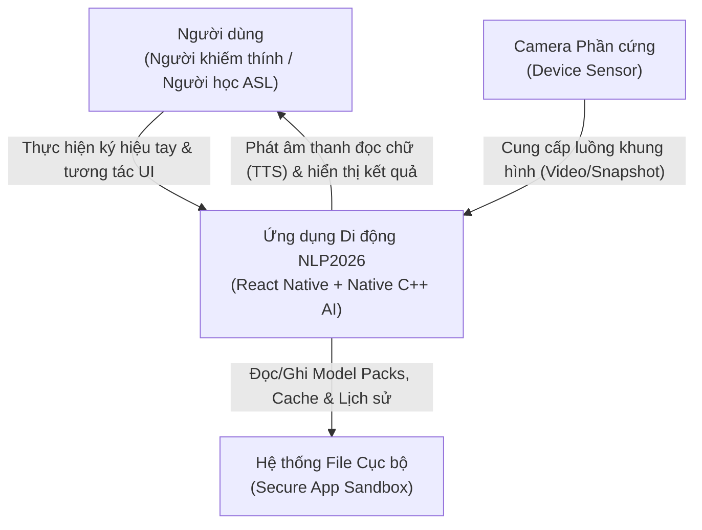
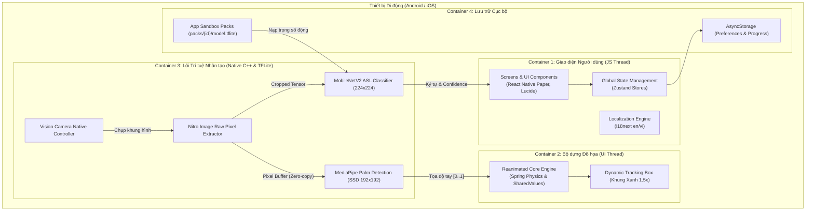

# NLP2026 Sign Language Detector — Technical Design & Architecture

Tài liệu thiết kế kỹ thuật chi tiết của hệ thống nhận diện ngôn ngữ ký hiệu di động thời gian thực (Real-time On-Device Sign Language Recognition).

---

## 1. 🏗️ Tổng quan Kiến trúc Hệ thống

Ứng dụng được thiết kế theo kiến trúc **Edge AI / Local-First**. Mọi công đoạn từ thu thập luồng camera, tiền xử lý khung hình, phát hiện bàn tay, theo dõi chuyển động, và phân loại ký tự đều diễn ra trực tiếp trên phần cứng của thiết bị (On-Device Inference), đảm bảo:
- **Zero-Latency:** Không phụ thuộc vào đường truyền mạng hay độ trễ của cloud server.
- **Bảo mật & Quyền riêng tư:** Luồng camera và hình ảnh của người dùng không bao giờ bị truyền tải ra ngoài thiết bị.
- **Hoạt động Ngoại tuyến 100%:** Người dùng có thể học tập, kiểm tra và phiên dịch ở bất cứ đâu.

---

## 2. 🧩 C4 Architecture Diagrams

### Level 1 — System Context Diagram



### Level 2 — Container Diagram



---

## 3. ⚡ Kiến trúc Xử lý AI Đa Luồng (Dual-Loop Pipeline)

Để giải quyết triệt để xung đột giữa việc quét đồ họa mượt mà (60 FPS) và suy luận mô hình AI nặng, hệ thống tách biệt luồng xử lý thành **2 vòng lặp độc lập**:

```text
[Camera Stream]
      │
      ├───────────────────────────────┐
      ▼                               ▼
[VÒNG LẶP 1: TRACKING LOOP]     [VÒNG LẶP 2: RECOGNITION LOOP]
- Tần số: 10 - 15 FPS           - Tần số: 1 - 2 FPS (Background C++)
- Giai đoạn A: MediaPipe SSD    - Kích hoạt khi ĐÃ KHÓA (TRACKING)
  (Tìm tay toàn màn hình 192x192)- Cắt đúng mảnh ảnh 224x224 quanh tay
- Giai đoạn B: CamShift HSV     - Chạy MobileNetV2 ASL Classifier
  (Bám vết màu da + Mẫu động)   - Trả về chữ cái & % tự tin
      │                               │
      ▼                               ▼
[Reanimated Shared Values]     [UI Result Banner & Text-to-Speech]
(Spring Physics khung xanh)
```

### 3.1. Vòng lặp 1: Định vị & Bám đuổi Bàn tay (Tracking Loop)
1. **Tìm kiếm (SEARCHING):** Khung hình được thu nhỏ về 192x192 và nạp vào **MediaPipe Palm Detection TFLite**. Giải mã 2016 anchors để tìm ô neo có độ tin cậy cao nhất.
2. **Kéo giãn & Đệm (Bounding Box Expansion):** Tính toán tâm bàn tay, nhân hệ số tỷ lệ 2.0x và đệm an toàn để tạo ra một hình vuông hoàn hảo bao trọn mọi ngón tay xòe.
3. **Chuyển trạng thái sang Khóa (TRACKING):** Tắt tạm thời AI MediaPipe để tiết kiệm pin. Kích hoạt thuật toán **CamShift** dựa trên dải màu da (HSV) với Mẫu động (Adaptive Hue Histogram) cập nhật liên tục 5% màu thực tế mỗi frame. Bổ sung trọng số mũ (Exponential Top-bias) ở 1/3 phía trên khung hình để ép trọng tâm dính chặt vào ngón tay, bất chấp phần cẳng tay phía dưới.
4. **Hiển thị (UI Thread):** Tọa độ tỷ lệ `[0..1]` được truyền thẳng vào Reanimated Shared Values. Khung xanh di chuyển mượt mà 60 FPS nhờ hiệu ứng lò xo (`withSpring`).

### 3.2. Vòng lặp 2: Nhận diện Ký hiệu (Sign Recognition Loop)
1. Luồng 2 chỉ hoạt động khi Luồng 1 xác nhận đang ở trạng thái `TRACKING`.
2. Trích xuất tọa độ hiện hành của Bounding Box và thực hiện thao tác cắt ảnh (Crop) chính xác vùng chứa bàn tay.
3. Chuyển đổi và chuẩn hóa mảng màu ảnh (chia 255.0 về khoảng `[0, 1]`).
4. Thực thi suy luận qua hàm bất đồng bộ `await tfliteModel.run()` trên nền Background Thread Pool của C++, đảm bảo hoàn toàn không làm đứng hình hay khựng UI.

---

## 4. 🗄️ Thiết kế Dữ liệu & Quản lý Bộ nhớ

### 4.1. Entity Schema (Zustand & AsyncStorage)
- **ModelPack:**
  - `id: string` — Mã định danh duy nhất của gói (vd: `asl_mobilenetv2_final_001`).
  - `name: string` — Tên hiển thị của gói.
  - `version: string` — Phiên bản gói mô hình (vd: `1.0.0`).
  - `inputShape: number[]` — Kích thước tensor đầu vào (vd: `[1, 224, 224, 3]`).
  - `normalization: string` — Hệ chuẩn hóa pixel (`[0, 1]`, `[-1, 1]`, `[0, 255]`).
  - `wordCount: number` — Số lượng từ vựng trong mô hình.
- **Word:**
  - `id: string`, `word: string`, `learned: boolean`, `favorite: boolean`.
- **HistoryItem:**
  - `id: string`, `sign: string`, `signs: string[]`, `mode: string`, `date: string`, `time: string`, `type: 'detection' | 'learning' | 'test'`, `testStats?: object`.

### 4.2. Cách ly Bộ nhớ & Xóa sạch Model (Sandboxing)
Mỗi gói mô hình được giải nén vào thư mục riêng biệt:
```text
${FileSystem.documentDirectory}packs/{packId}/
├── model.tflite
├── metadata.json
├── README.md
└── vocabulary/
    ├── word_list.json
    └── word_images/
```
Khi người dùng yêu cầu xóa một gói mô hình, toàn bộ thư mục `${FileSystem.documentDirectory}packs/{packId}/` sẽ bị xóa đệ quy, đảm bảo không lưu lại bất kỳ rác bộ nhớ nào (Zero Storage Bloat).

---

## 5. ⚖️ Các Quyết định Kỹ thuật Quan trọng (ADR)

1. **ADR-01: Sử dụng `react-native-fast-tflite` thay vì TensorFlow.js**
   - *Ngữ cảnh:* TensorFlow.js trên React Native chạy qua WebGL/CPU JS Thread, gây nghẽn giao diện và FPS chỉ đạt 2-4 FPS.
   - *Quyết định:* Chuyển sang `react-native-fast-tflite` kết hợp `react-native-nitro-modules`.
   - *Hệ quả:* Tận dụng lõi TFLite Native C++ với XNNPACK delegate, đưa tốc độ suy luận đạt 15-30 FPS mượt mà.
2. **ADR-02: Tách biệt Tracking Loop (CamShift) và Recognition Loop (MobileNetV2)**
   - *Ngữ cảnh:* Gọi mô hình phân loại chữ liên tục ở 15 FPS khiến CPU bị quá tải và nóng máy.
   - *Quyết định:* Phân tách thành 2 luồng: luồng theo dõi tay chạy nhanh bằng thuật toán quang học nhẹ (CamShift), luồng nhận diện ký hiệu chỉ chạy ngầm 1-2 lần/giây khi tay đã ổn định trong khung.
3. **ADR-03: Render Bounding Box trên UI Thread thông qua Reanimated SharedValues**
   - *Ngữ cảnh:* Truyền tọa độ Bounding Box qua React State làm kích hoạt re-render liên tục trên JS Thread gây giật lag.
   - *Quyết định:* Cập nhật trực tiếp vào `useSharedValue` và áp dụng lò xo `withSpring` trên UI Thread.
